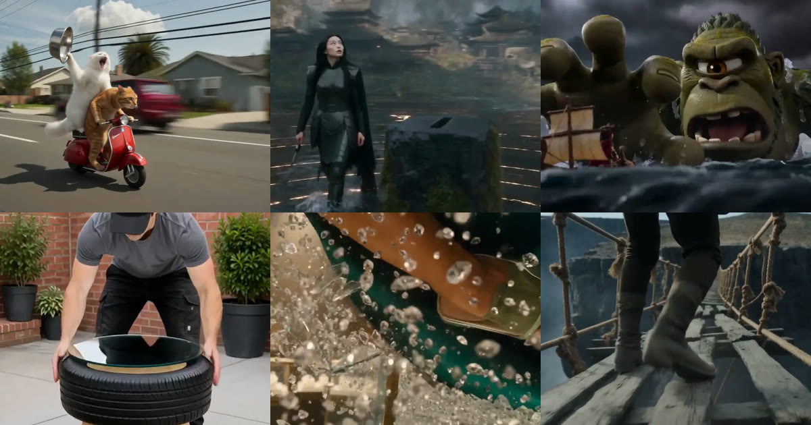

<div align="center">

<a href="https://apiko.app/zh/seedance-2-0-prompts?utm_source=github&utm_medium=banner&utm_campaign=awesome-seedance-2.0-prompts"></a>

[](../LICENSE)
[](../README_zh-CN.md#menu)
[](https://apiko.app/zh/models/seedance-2.0?utm_source=github&utm_medium=badge&utm_campaign=awesome-seedance-2.0-prompts&utm_content=model_try)
[](https://apiko.app/zh/docs/api-manual/video-series/seedance/seedance-2.0?utm_source=github&utm_medium=badge&utm_campaign=awesome-seedance-2.0-prompts&utm_content=docs)

[](cinematic.md)
[](cinematic_zh-CN.md)
[](cinematic_zh-TW.md)
[](cinematic_ko.md)

</div>

# 🎬 电影感 · Awesome Seedance 2.0 提示词

[← 返回 README](../README_zh-CN.md) · 本页共 20 条。提示词保持原文，未翻译。

> 靠一个镜头创意撑起的单场景：像人一样的动物、微距、超现实瞬间。

- [从车里拍到两只猫骑红色小摩托](#cinematic-01)
- [70mm 胶片质感的沙漠风暴史诗](#cinematic-02)
- [乌鸦抱住灰猫后结伴离开](#cinematic-03)
- [给巨型布偶猫洗澡吹毛](#cinematic-04)
- [一战战壕里的橘猫士兵](#cinematic-05)
- [小棕熊开着复古蓝车穿过农场](#cinematic-06)
- [微缩海岛上自动拼起港口小镇](#cinematic-07)
- [细条纹西装走进会议室的气场](#cinematic-08)
- [大学物理实验室里的斜轨小球实验](#cinematic-09)
- [林间骑行突遇斑马群](#cinematic-10)
- [蓝色光窗与烟雾中的漂浮人影](#cinematic-11)
- [猫总裁和兔子保洁的办公室恋爱](#cinematic-12)
- [雨夜车窗上划过的指尖](#cinematic-13)
- [暗色霓虹舞蹈室里的音乐短片](#cinematic-14)
- [无底峡谷上逐渐消散的吊桥](#cinematic-15)
- [用一张图当首帧做音乐视频](#cinematic-16)
- [参考图里的猫穿衬衫走过酒店大堂](#cinematic-17)
- [机械苍蝇展开成精密齿轮](#cinematic-18)
- [高冷猫咪的奢华护肤日常](#cinematic-19)
- [镜中倒影反噬发牌人的惊悚短片](#cinematic-20)

<a id="cinematic-01"></a>
### 1. 从车里拍到两只猫骑红色小摩托

作者 [@Just_sharon7](https://x.com/Just_sharon7) · 15 秒 · 16:9 · **[▶ 在 APIKO 运行](https://apiko.app/zh/seedance-2-0-prompts?utm_source=github&utm_medium=case&utm_campaign=awesome-seedance-2.0-prompts&utm_content=cinematic-01#cinematic-01)** · [原帖](https://x.com/Just_sharon7/status/2084901309988425731)

https://github.com/user-attachments/assets/a73e7827-858a-4f85-862a-f39b6bd24fd8

**提示词:**

```text
A highly realistic cinematic shot filmed from inside a moving car looking out the side window, capturing two cats riding a small red mini motorcycle on a suburban road. An orange tabby cat is driving, gripping the handlebars with both front paws, mouth open in a surprised or determined expression, ears slightly back from the wind. Behind it, a fluffy pure white cat is perched as a passenger, holding up a shiny empty metal food bowl with one paw while the other rests for balance, mouth wide open as if meowing or yelling. The motorcycle is a compact red mini bike with a visible headlight, black tires, and a small license plate area. Background shows a typical American suburban street with houses, trees, power lines, a concrete barrier, other cars passing, and a partly cloudy sky. Dynamic motion blur on the background to convey speed, natural daylight, humorous and absurd vibe.
```

<a id="cinematic-02"></a>
### 2. 70mm 胶片质感的沙漠风暴史诗

作者 [@johnAGI168](https://x.com/johnAGI168) · 15 秒 · 16:9 · **[▶ 在 APIKO 运行](https://apiko.app/zh/seedance-2-0-prompts?utm_source=github&utm_medium=case&utm_campaign=awesome-seedance-2.0-prompts&utm_content=cinematic-02#cinematic-02)** · [原帖](https://x.com/johnAGI168/status/2020794007291404726)

https://github.com/user-attachments/assets/5cc6f9a5-cc3c-4ecd-87be-c213a145855f

**提示词:**

```text
Style: IMAX 70mm Film, Denis Villeneuve Style, Gritty Realism, Epic Scale, Desaturated.
Duration: 15s.
[00-05s] Extreme Wide Shot (The Scale). A colossal sandstorm, miles high, swallows a vast desert landscape. A tiny convoy of armored military vehicles races away from it. The scale of nature vs man is terrifying. Hans Zimmer style tension.
[05-10s] Cockpit Cam (The Panic). Inside the lead rover. The pilot screams "GO! GO!" (Subtitle: MAX POWER!). Camera shakes violently. Sand blasts the windshield. The sun is blocked out by the approaching wall of dust.
[10-15s] The Jump (The Climax). The rover hits a massive dune and launches into the air (Slow Motion). Silhouette against the dark storm. Lightning strikes within the dust cloud. Debris flies past the lens. Cut to black on impact.
```

<a id="cinematic-03"></a>
### 3. 乌鸦抱住灰猫后结伴离开

作者 [@soulful__ai](https://x.com/soulful__ai) · 15 秒 · 16:9 · **[▶ 在 APIKO 运行](https://apiko.app/zh/seedance-2-0-prompts?utm_source=github&utm_medium=case&utm_campaign=awesome-seedance-2.0-prompts&utm_content=cinematic-03#cinematic-03)** · [原帖](https://x.com/soulful__ai/status/2103056454395855115)

https://github.com/user-attachments/assets/9ad51ec0-1554-4e35-9847-2ca1647079d1

**提示词:**

```text
Create a realistic, funny, heartwarming handheld phone video of a real-looking black crow and a realistic fluffy gray cat inside a simple apartment hallway.

The gray cat wears a small pink bow attached naturally to the top of her head. The bow stays securely in place throughout the entire video.

0–3 sec:
The crow stands in the middle of the hallway, looking around naturally. The gray cat appears in the distance and notices the crow. She immediately runs toward him with excited, playful energy.

3–6 sec:
The cat reaches the crow. The crow turns toward her and gently spreads both wings around the cat, creating the appearance of a sweet little hug. The cat leans into the crow affectionately. Their interaction should feel spontaneous and physically believable.

6–10 sec:
After the hug, the crow starts walking forward down the hallway while the gray cat walks closely beside him. They move together like an unlikely little pair of friends. The crow occasionally looks toward the cat while walking.

10–12 sec:
The cat briefly looks up at the crow, then they continue walking away together.

Visual style

Extremely realistic animals

Real crow anatomy, feathers, feet and beak

Realistic fluffy gray cat fur and natural movement

Small pink bow on the cat's head

Ordinary apartment hallway

Handheld smartphone camera

Slight camera shake and imperfect framing

Natural indoor lighting

Slightly compressed, 144p/low-quality viral social-media video aesthetic

Mild motion blur and phone-camera autofocus

No cinematic color grading

No CGI appearance

No cartoon look

No exaggerated facial expressions

No human hands

Keep the animals anatomically realistic while making the hug physically believable

Spontaneous, funny, wholesome internet-video feeling

Single continuous shot, no cuts or transitions
```

<a id="cinematic-04"></a>
### 4. 给巨型布偶猫洗澡吹毛

作者 [@Aiwithmaha](https://x.com/Aiwithmaha) · 30 秒 · 16:9 · **[▶ 在 APIKO 运行](https://apiko.app/zh/seedance-2-0-prompts?utm_source=github&utm_medium=case&utm_campaign=awesome-seedance-2.0-prompts&utm_content=cinematic-04#cinematic-04)** · [原帖](https://x.com/Aiwithmaha/status/2110921969420177453)

https://github.com/user-attachments/assets/5d1045a3-4ebb-486a-99e4-3b19226736f5

**提示词:**

```text
30-second ultra-realistic cinematic video prompt: Create a heartwarming, funny, and visually stunning 30-second video featuring an enormous, fluffy white-and-gray Ragdoll cat with beautiful blue eyes, a pink nose, and extremely soft, thick fur, sitting outside a modern house. A beautiful young Korean woman with long, straight dark hair, a natural smile, and a casual navy-blue outfit approaches the giant cat on a sunny afternoon. She gently sprays water over the cat using a green garden hose, soaking its thick fur while the cat remains calm and adorable. Show realistic water droplets falling from its fur, with detailed wet hair and natural feline expressions. The woman smiles and laughs while carefully washing the giant cat in the driveway, surrounded by greenery and warm sunlight. Transition smoothly to a cozy garage scene where she uses a handheld hair dryer to dry the enormous cat's fluffy coat. The cat closes its eyes happily as warm air blows through its fur, making it look even bigger and funnier. Use realistic animal movements, natural human expressions, cinematic camera angles, soft golden-hour lighting, detailed fur physics, and seamless transitions. Maintain consistent character appearances throughout the video, with photorealistic quality, natural ambient sounds, and no text, logos, or watermarks.
```

<a id="cinematic-05"></a>
### 5. 一战战壕里的橘猫士兵

作者 [@Aiwithmaha](https://x.com/Aiwithmaha) · 15 秒 · 9:16 · **[▶ 在 APIKO 运行](https://apiko.app/zh/seedance-2-0-prompts?utm_source=github&utm_medium=case&utm_campaign=awesome-seedance-2.0-prompts&utm_content=cinematic-05#cinematic-05)** · [原帖](https://x.com/Aiwithmaha/status/2105847315609293134)

https://github.com/user-attachments/assets/d2d26478-6f8d-41dd-bf8b-6f25d8d79fd6

**提示词:**

```text
Create a 15-second vertical 9:16 photorealistic cinematic video of a cute orange tabby cat inside a muddy World War-style trench, wearing a realistic olive-green military helmet and holding a small vintage rifle. Start with the camera focused on the dark trench entrance, with stacked sandbags and rough wooden planks clearly visible above. At first, only the top of the helmet slowly appears from the trench. The cat gradually rises into view while holding the rifle naturally with both paws. Keep the cat’s face, fur, helmet, rifle, trench, and background consistent throughout the entire video. Around the middle, the cat looks directly toward the camera with a serious but adorable expression and slowly raises one paw in a small salute. Maintain realistic fur movement, natural paw motion, subtle head movement, and cinematic depth of field. The camera should remain mostly stable with a very gentle handheld cinematic movement. Near the end, the cat lowers its paw and slowly ducks back down into the trench, leaving only the helmet visible. Use realistic outdoor lighting, soft overcast sky, detailed muddy soil, natural textures, shallow depth of field, smooth motion, and no text, watermark, distortion, or extra characters.
```

<a id="cinematic-06"></a>
### 6. 小棕熊开着复古蓝车穿过农场

作者 [@Lianaalane](https://x.com/Lianaalane) · 30 秒 · 16:9 · **[▶ 在 APIKO 运行](https://apiko.app/zh/seedance-2-0-prompts?utm_source=github&utm_medium=case&utm_campaign=awesome-seedance-2.0-prompts&utm_content=cinematic-06#cinematic-06)** · [原帖](https://x.com/Lianaalane/status/2099404551199809774)

https://github.com/user-attachments/assets/6868ef98-90a4-4643-a5ab-001ae98f7ee2

**提示词:**

```text
Created a video in a cinematic, ultra-realistic storytelling style: a cute brown bear cub walks across a peaceful countryside farm toward an old vintage blue car parked near a rustic wooden barn. The bear curiously approaches the car, climbs inside, and naturally sits in the driver’s seat with its paws on the steering wheel. The camera captures close-up details of the bear’s realistic fur, expressive eyes, tiny paws, and the aged interior of the classic car. The car then starts moving slowly along a wet rural road, creating subtle reflections and natural motion. Wide cinematic shots reveal green fields, hay bales, a small farmhouse, and warm golden-hour sunlight in the background. Use smooth camera movements, realistic depth of field, soft lens flare, natural shadows, detailed textures, and authentic environmental lighting. The overall mood should feel charming, adventurous, cinematic, and slightly playful, with realistic animal movement and believable interaction with the car, filmed like a high-budget wildlife movie.
```

<a id="cinematic-07"></a>
### 7. 微缩海岛上自动拼起港口小镇

作者 [@ai_lifehack55](https://x.com/ai_lifehack55) · 15 秒 · 1:1 · **[▶ 在 APIKO 运行](https://apiko.app/zh/seedance-2-0-prompts?utm_source=github&utm_medium=case&utm_campaign=awesome-seedance-2.0-prompts&utm_content=cinematic-07#cinematic-07)** · [原帖](https://x.com/ai_lifehack55/status/2076503632988561413)

https://github.com/user-attachments/assets/7ea60454-edff-4ba4-9dc6-36b0934c434f

**提示词:**

```text
[CONDITION DEFINITION]
1:1スクエア、15秒、参照画像なし。広大な島全体に港町が高速で組み上がる、シネマティックな高級ミニチュア・ジオラマ形成モンタージュ。方向性は、チープな玩具ではなく、高級な手作りジオラマ、高級コレクタートイ、映画撮影用の精密模型のような質感。可愛らしさ、整理された美しさ、模型ならではの楽しさを残しつつ、島全体が大きく広がる壮大感を出す。明るくクリアな昼光、青い海、白い波、赤・青・白の屋根、木の桟橋、石の岸壁、灯台、橋、運河、丘の上の街並み、複数の港区画を見せる。主役は人物ではなく、巨大な港島ジオラマそのもの。文字、ロゴ、透かし、字幕は不要。

[SHOT/FLOW]
0.0〜3.0秒：
広角の高い俯瞰ショットから開始する。小さな箱庭ではなく、青い海に囲まれた大きな島全体を見せる。何もない島の地形に、海岸線、湾、防波堤、崖、丘、港口、運河、複数の岸壁、橋、主要道路、段差のある街区の輪郭が高速で現れ、まず島と港の大きな骨格が一気に完成する。最初から外海、湾、丘、港の広がりを見せ、こじんまりした印象を避ける。
3.0〜6.5秒：
カメラは広角を保ったまま、ゆるやかに下降しながら港側へ前進する。木の桟橋、石畳、階段、手すり、倉庫、漁具小屋、運河沿いの建物、赤・青・白の屋根の家並み、丘へ続く細い道が、カチッとはまるようにテンポよく組み上がる。寄りすぎず、常に港・丘・外海の奥行きが見える構図にする。
6.5〜10.0秒：
自然な場面転換を入れ、港の中距離ショットへ移る。複数の桟橋、小舟、帆船、係留ロープ、木箱、小型クレーン、街灯、旗、橋、運河、岸壁の石の継ぎ目、桟橋の板などの細部が連続して完成する。ここは形成の快感を最も強く見せる場面だが、小物の寄りだけにせず、広い港区画全体が一気に密度を増していくように見せる。
10.0〜12.5秒：
灯台、丘の上の街並み、複数の港区画、外海へ続く湾を見せる。灯台が完成し、屋根、窓、橋、街灯、船、旗が最後の仕上げとして整い、広大な港島ジオラマが完成形に近づく。ここで島全体のスケール感をもう一度強く見せる。
12.5〜15.0秒：
完成した港島に命が宿る。水面がきらめき、小舟が少し揺れ、旗とロープが風になびき、灯台の光がゆっくり回り、窓や街灯が小さく点灯する。最後は広角で大きく引いた壮大な全景。港, 丘, 灯台, 複数の桟橋, 外海まで含めて, 大きな高級ジオラマ島が可愛らしく息づき始めた余韻で締める。

[CAMERA/EDITING]
カメラは広角を重視し、島全体の広がりを常に感じさせる。開始は高い俯瞰、次に下降前進、港沿いの近接通過、灯台まわりの軽い回り込み、最後は大きく引いた全景。15秒内に2〜3回の自然な場面転換を入れる。寄りカットは入れてよいが、寄りすぎて小さな玩具だけに見えないようにする。前景・中景・遠景を重ね、港、丘、灯台、外海が同時に見える構図を作る。テンポは速く、形成の快感を重視する。単調な直線移動や長い静止は避ける。

[SOUND]
BGMあり、効果音あり。BGMは明るく爽快で、少し冒険感のあるシネマティックな音楽。高級ジオラマが完成していく高揚感を支えるが、派手すぎない。効果音は小さな組み立て音、木や石がはまる音、軽いクリック音、水音、波のさざめき、ロープや旗の音、船のきしみ、遠いカモメ、灯台の小さな機械音。セリフなし、ナレーションなし。

[NEGATIVE]
小さすぎる島、こじんまりした箱庭、安い玩具感、チープなプラスチック感、雑なクラフト感、狭い港、数軒だけの町、スケールのない構図、暗い曇天、濁った海、実物大の巨大人間、人物主役化、文字、ロゴ、透かし、字幕、単調な直線カメラ、完成後に完全静止するだけのラストを避ける。
```

<a id="cinematic-08"></a>
### 8. 细条纹西装走进会议室的气场

作者 [@noorlewisx](https://x.com/noorlewisx) · 16 秒 · 16:9 · **[▶ 在 APIKO 运行](https://apiko.app/zh/seedance-2-0-prompts?utm_source=github&utm_medium=case&utm_campaign=awesome-seedance-2.0-prompts&utm_content=cinematic-08#cinematic-08)** · [原帖](https://x.com/noorlewisx/status/2089217062040453196)

https://github.com/user-attachments/assets/5a319fa1-f19e-4deb-893b-457a7cc8bee9

**提示词:**

```text
A cinematic, stylish sequence of a confident young woman with short curly brown hair, bold red lipstick, and a statement necklace. She wears a sharp grey pinstripe oversized blazer and matching trousers with bright red pointed high heels.
Starts with a close-up of her red heels stepping out of a black luxury car onto a wet city street at dusk. She walks confidently through revolving glass doors into a modern office building, presses the elevator button, checks her tablet in the mirrored elevator, then enters a boardroom. She presents charts and graphs on a large screen to a group of executives in suits, gestures confidently while speaking, signs a document, shakes hands with a senior executive, checks her elegant wristwatch with a burgundy leather strap, and finally walks across a glass-walled rooftop terrace overlooking the New York City skyline at golden hour, wind lightly moving her hair, powerful and composed expression.
Moody cinematic lighting, wet reflections, sharp fashion photography style, high-end commercial aesthetic, 16:9.
```

<a id="cinematic-09"></a>
### 9. 大学物理实验室里的斜轨小球实验

作者 [@aiwithaayat](https://x.com/aiwithaayat) · 30 秒 · 16:9 · **[▶ 在 APIKO 运行](https://apiko.app/zh/seedance-2-0-prompts?utm_source=github&utm_medium=case&utm_campaign=awesome-seedance-2.0-prompts&utm_content=cinematic-09#cinematic-09)** · [原帖](https://x.com/aiwithaayat/status/2102331859657253174)

https://github.com/user-attachments/assets/c44dc8d4-ecf5-44c5-acd2-ca6d1b134be3

**提示词:**

```text
Create a cinematic, realistic educational video set inside a modern university physics laboratory. A confident male physics professor walks into the classroom carrying a coffee cup and a notebook, while students sit attentively in a large lecture hall. The scene then transitions to a hands-on physics experiment where the professor and a group of students gather around a transparent inclined track. A small metallic ball is carefully placed on the track, creating a clear visual demonstration of motion, gravity, acceleration, and energy. Show detailed close-up shots of the transparent rail, metal ball, students observing closely, and the professor guiding the experiment with natural hand movements. Use smooth camera movements, realistic depth of field, natural facial expressions, and authentic classroom interactions to make the experiment feel engaging and believable. Include cinematic laboratory lighting with soft indoor illumination and warm sunlight entering through large windows. End with the professor working at a laboratory table during golden-hour lighting, surrounded by scientific equipment, creating a thoughtful and inspiring academic atmosphere.
```

<a id="cinematic-10"></a>
### 10. 林间骑行突遇斑马群

作者 [@Aiwithmaha](https://x.com/Aiwithmaha) · 30 秒 · 16:9 · **[▶ 在 APIKO 运行](https://apiko.app/zh/seedance-2-0-prompts?utm_source=github&utm_medium=case&utm_campaign=awesome-seedance-2.0-prompts&utm_content=cinematic-10#cinematic-10)** · [原帖](https://x.com/Aiwithmaha/status/2113222820570550355)

https://github.com/user-attachments/assets/b3a49881-564e-40c7-b886-da070749e0ea

**提示词:**

```text
Create a cinematic, photorealistic 30-second video of a young woman riding a bicycle along a dirt road through a lush green forest. She wears a black baseball cap, a loose blue T-shirt, black shorts, and white sneakers, with long brown hair flowing naturally behind her. She rides confidently with her arms stretched outward before looking back and noticing a large herd of zebras running toward her. She reacts with shock and fear, quickly grips the handlebars, and pedals faster as the zebras charge down the road, raising clouds of dust. Dozens of zebras run around her bicycle, creating an intense and thrilling chase scene. She eventually slows down, looks at her smartphone in disbelief, and raises it to her ear with wide eyes and an open mouth. Use smooth tracking shots, realistic bicycle movement, natural animal motion, detailed zebra stripes, flowing hair, dust particles, and soft daylight. Maintain consistent characters, realistic physics, and natural expressions throughout the video, with no unnatural morphing, no text, and no background music.
```

<a id="cinematic-11"></a>
### 11. 蓝色光窗与烟雾中的漂浮人影

作者 [@itsSaira_1](https://x.com/itsSaira_1) · 13 秒 · 16:9 · **[▶ 在 APIKO 运行](https://apiko.app/zh/seedance-2-0-prompts?utm_source=github&utm_medium=case&utm_campaign=awesome-seedance-2.0-prompts&utm_content=cinematic-11#cinematic-11)** · [原帖](https://x.com/itsSaira_1/status/2110947923412566187)

https://github.com/user-attachments/assets/9bd2ae74-6b8c-4bcb-88e1-22ebb67ebf91

**提示词:**

```text
Create a 12.8-second surreal cinematic art video in 16:9 format, with a deep black background, electric-blue windows, and monochromatic smoke.

SHOT 1 (0:00–0:01): A single glowing blue four-pane window contains a human figure floating horizontally above a faint rocky ledge.

SHOT 2 (0:01–0:03): The window dissolves into darkness, leaving the same floating human figure in grayscale as thin smoky strands emerge around the body.

SHOT 3 (0:03–0:05): Feather-like smoke filaments curl into an elongated elliptical ring around the suspended figure.

SHOT 4 (0:05–0:07): Gray-white smoky ribbons sweep horizontally around the body, stretching and flowing through the black environment.

SHOT 5 (0:07–0:08): The smoke dissolves as a glowing blue window smoothly reappears behind the floating figure.

SHOT 6 (0:08–0:10): The single window expands into multiple irregularly arranged blue windows, each containing a human figure in a different floating pose.

SHOT 7 (0:10–0:12.8): Reveal the complete installation of glowing blue windows against a dark textured background, with suspended figures and subtly shimmering light.

STYLE & MOTION: Surreal fine-art cinematography, deep blacks, cold blue illumination, grayscale figures, delicate smoke, volumetric lighting, subtle film grain, smooth morphing transitions, steady wide camera, consistent human anatomy and clothing.

NEGATIVE PROMPT: No eyes, eyeballs, colorful neon, bright rooms, sudden cuts, fast spins, abrupt zooms, distorted anatomy, extra limbs, unintended duplication, text, logos, or watermarks.

#Ai #AIart️️️️️️️️️️️️️️️️️️️️️️️️️️️️️️️️️️️️️️️️️️️️️️️️️️️ #visualart #Darkfantasy
```

<a id="cinematic-12"></a>
### 12. 猫总裁和兔子保洁的办公室恋爱

作者 [@Rayko_wang](https://x.com/Rayko_wang) · 10 秒 · 16:9 · **[▶ 在 APIKO 运行](https://apiko.app/zh/seedance-2-0-prompts?utm_source=github&utm_medium=case&utm_campaign=awesome-seedance-2.0-prompts&utm_content=cinematic-12#cinematic-12)** · [原帖](https://x.com/Rayko_wang/status/2021949028481843527)

https://github.com/user-attachments/assets/6b25a4ad-d962-432a-9043-2091f9620bb5

**提示词:**

```text
Use cute pet images to unfold a story about a overbearing president falling in love with a cleaning
girl, with anthropomorphic standing poses.
```

<a id="cinematic-13"></a>
### 13. 雨夜车窗上划过的指尖

作者 [@AIwithMinal](https://x.com/AIwithMinal) · 15 秒 · 16:9 · **[▶ 在 APIKO 运行](https://apiko.app/zh/seedance-2-0-prompts?utm_source=github&utm_medium=case&utm_campaign=awesome-seedance-2.0-prompts&utm_content=cinematic-13#cinematic-13)** · [原帖](https://x.com/AIwithMinal/status/2093560634822762971)

https://github.com/user-attachments/assets/84e4d7e6-0c6b-4b0b-83a6-d54d30c96975

**提示词:**

```text
Cinematic close-up of a delicate feminine hand gently touching a rain-covered car window, tiny raindrops and water trails visible on the glass, blurred city lights glowing in blue, red, and white tones outside, dreamy nighttime atmosphere, emotional and melancholic mood, shallow depth of field, creamy bokeh, soft ambient lighting, realistic skin texture, cinematic color grading, ultra-realistic photography, 85mm lens, f/1.8, HDR, highly detailed, vertical 9:16 composition.
```

<a id="cinematic-14"></a>
### 14. 暗色霓虹舞蹈室里的音乐短片

作者 [@PixelAigc](https://x.com/PixelAigc) · 15 秒 · 16:9 · **[▶ 在 APIKO 运行](https://apiko.app/zh/seedance-2-0-prompts?utm_source=github&utm_medium=case&utm_campaign=awesome-seedance-2.0-prompts&utm_content=cinematic-14#cinematic-14)** · [原帖](https://x.com/PixelAigc/status/2078846287500439682)

https://github.com/user-attachments/assets/49311c66-853f-4c69-8778-342b65d76505

**提示词:**

```text
生成视频：一部电影般的 10 秒音乐视频，拍摄于一个黑暗的现代舞蹈工作室，带有光滑的灰色反光地板、黑色墙壁和水平霓虹灯管。连续的动态摄像机运动，主要为中景和特写，绝不拉得太宽。女主角始终在移动，没有冻结或静态姿势。

主要角色：20岁年轻东亚女性，凌乱的中长波浪黑发，前额刘海部分遮住脸庞，冷白皮，黑色眼睛，丰满光泽的嘴唇。她穿着白色真丝吊带连衣裙。她全程在唱歌，唇部同步清晰精确，嘴巴积极动作，强烈的感情表达。

歌词：“ねえ、君は名前の入った箱をしまっているんだね / ベッド脇の引き出しの中に / ポラロイド写真やチケットの半券を / 赤いものの下に詰め込んで / 君はただ一つだけを持っていくんじゃなくて / 最後の残り火のすべてをさらっていく / そして、それぞれの秘められた心に / 小さな指の跡を残していくんだ”。

0-2s：紧凑的中近景。她上身向后倾斜，头部侧倾，热情地唱歌，唇部同步强烈，头发垂落到脸上，身体弓起，一只手滑过胸膛。

2-4s：摄像机缓慢推进并环绕。她从深弓姿势中恢复，躯干仍向前弯曲，双手放在大腿上，抬起头直视摄像机，同时以激进的唇部同步唱歌。三位外貌不同的男舞者（不同种族、发型和体型），穿着黑色背心和黑色宽松裤，已经靠近她周围，以低张力的姿势与她一同移动。另外两个男舞者在画面边缘可见，正在接近。

4-6s：中近景。她向下蹲低，身体仍持续运动，头发摆动，激烈地唱歌，嘴巴动作清晰，头部锐利转动，眼睛锁定摄像机。男舞者保持靠近，他们的手在共同移动时轻轻触碰她。

6-8s：中景，伴随缓慢的摄像机漂移。精确的五位外貌完全不同的男舞者，全都穿着黑色背心和黑色宽松裤，在地板上以密集交织的阵型紧紧包围她。她位于中心，身体仍在移动，上身上升和转移，以强烈的唇部同步唱歌。五位男舞者都与她微妙地移动，从不静态。男舞者绝不完全遮挡她的身体。

8-10s：动态中景。五位多样化的男舞者将她举到空中，进入一个有力的深后弯姿势。她的身体完全伸展并弓起，头部向后甩，仍以清晰的唇部同步唱歌。他们托举着她，轻轻地随着节拍上下摇动。摄像机从她弓起身体的清晰侧视图开始，平滑过渡到她脸部的正面视图。结尾时，他们平滑地将她降落到脚上；她落地后立即继续唱歌，五位男舞者保持低姿势围绕在她周围。男舞者绝不完全遮挡她。

高端时尚舞蹈能量，汗湿的皮肤，锐利的时机，女主角连续流畅的运动，每一帧都优先确保准确的唇部同步。

规则：无手部变形，无身体扭曲，干净稳定的解剖结构，手指和手部在整个视频中保持一致和自然。，16:9
```

<a id="cinematic-15"></a>
### 15. 无底峡谷上逐渐消散的吊桥

作者 [@zyvaoz](https://x.com/zyvaoz) · 15 秒 · 16:9 · **[▶ 在 APIKO 运行](https://apiko.app/zh/seedance-2-0-prompts?utm_source=github&utm_medium=case&utm_campaign=awesome-seedance-2.0-prompts&utm_content=cinematic-15#cinematic-15)** · [原帖](https://x.com/zyvaoz/status/2081398750996746385)

https://github.com/user-attachments/assets/f87e11b6-1311-4689-a53f-ce51683d2b29

**提示词:**

```text
0-3 sec:
A vast canyon with no visible bottom. A rope bridge spans the gap, wooden planks suspended on frayed ropes. A lone traveler steps onto the first plank.

3-6 sec:
The traveler takes a step. Behind them, the plank they left dissolves into mist. The ropes unravel silently. The bridge shortens. No return possible.

6-9 sec:
More steps. Each plank crumbles after use. The traveler glances back. Nothing but empty air. They grip the rope rail tighter. The end grows closer.

9-12 sec:
The traveler runs now. Planks dissolve faster. The bridge disintegrates behind them in a cascading wave. The far edge approaches. One final leap.

12-15 sec:
The traveler lands on solid ground. They turn. The entire bridge is gone. Only the two rope stumps remain, swaying over the void. Fade to black.

Sound: Wood creak, plank snap, rope fray, running footsteps, landing thud, silence.
```

<a id="cinematic-16"></a>
### 16. 用一张图当首帧做音乐视频

作者 [@RareParkStudios](https://x.com/RareParkStudios) · 15 秒 · 16:9 · **[▶ 在 APIKO 运行](https://apiko.app/zh/seedance-2-0-prompts?utm_source=github&utm_medium=case&utm_campaign=awesome-seedance-2.0-prompts&utm_content=cinematic-16#cinematic-16)** · [原帖](https://x.com/RareParkStudios/status/2079917613149503813)

https://github.com/user-attachments/assets/b3fdb37d-6fd9-4870-ac5d-bfea72360f37

> 📎 这条需要你自己上传参考图或参考视频。

**提示词:**

```text
generate an interesting music video using this image as first frame,be professional and use dynamic visuals
```

<a id="cinematic-17"></a>
### 17. 参考图里的猫穿衬衫走过酒店大堂

作者 [@meAsifAi](https://x.com/meAsifAi) · 10 秒 · 9:16 · **[▶ 在 APIKO 运行](https://apiko.app/zh/seedance-2-0-prompts?utm_source=github&utm_medium=case&utm_campaign=awesome-seedance-2.0-prompts&utm_content=cinematic-17#cinematic-17)** · [原帖](https://x.com/meAsifAi/status/2114406947558764575)

https://github.com/user-attachments/assets/99b61e9b-5390-4272-8c5e-c9742524bdd2

> 📎 这条需要你自己上传参考图或参考视频。

**提示词:**

```text
**DURATION:** 8 seconds  
**FORMAT:** Vertical 9:16, cinematic photorealism  
**REFERENCE:** Use the uploaded cat image as the exact first-frame and character reference.

**CHARACTER CONSISTENCY:** The exact same orange-and-cream tabby cat wearing the same pink casual button-up shirt and beige trousers. Preserve its original face, eye shape, ears, fur markings, body proportions, outfit, and tail throughout the entire video.

**MUSIC:** Cool, rhythmic contemporary dance-pop instrumental with a deep, groovy bass, crisp percussion, and stylish club beats. Music begins immediately. Dance movements must match the beat.

**DANCE CHOREOGRAPHY:**

**0–2 seconds:** The cat starts in a relaxed, confident standing pose. It performs a smooth shoulder roll, subtle chest isolation, and controlled side-to-side hip movement while maintaining eye contact with the camera.

**2–4 seconds:** The cat executes clean, stylish footwork, stepping right and left while moving its arms rhythmically across the torso. Natural wrist movements, relaxed elbows, and controlled upper-body grooves.

**4–6 seconds:** The cat performs a smooth body wave, a confident two-step, and coordinated arm sweeps. Its torso and hips move independently in a physically coherent, human-like dance style.

**6–8 seconds:** The cat executes two sharp beat-matched steps, a smooth shoulder pop, and finishes with a cool, confident pose facing the camera.

**CRITICAL HEAD AND NECK CONTROL:** The cat's head remains anatomically stable and naturally connected to its neck. Only subtle, realistic head tilts and small beat-synchronized movements are allowed. The head must NEVER rotate 360 degrees, flip backward, twist unnaturally, detach, or rotate independently of the body. Keep the eyes, ears, muzzle, and facial structure consistent in every frame.

**REALISM LOCK:** Natural weight transfer, grounded feet, believable balance, smooth transitions between dance moves, realistic fur and fabric physics, consistent shadows, continuous motion, and stable anatomy. One uninterrupted shot with a steady full-body camera and no sudden camera movements.

**NEGATIVE CONSTRAINTS:** No cartoon movement, no childish dancing, no exaggerated facial expressions, no rubber-like limbs, no unnatural spine bending, no neck twisting, no head spinning, no extra limbs, no face morphing, no outfit changes, no floating, no flickering, no sudden pose jumps, no artificial-looking motion.

**FINAL RESULT:** A stylish, confident, adult-inspired dance performance by the same photorealistic anthropomorphic cat, with smooth choreography, natural head movement, and convincing physical motion.
```

<a id="cinematic-18"></a>
### 18. 机械苍蝇展开成精密齿轮

作者 [@sebatheepan](https://x.com/sebatheepan) · 15 秒 · 16:9 · **[▶ 在 APIKO 运行](https://apiko.app/zh/seedance-2-0-prompts?utm_source=github&utm_medium=case&utm_campaign=awesome-seedance-2.0-prompts&utm_content=cinematic-18#cinematic-18)** · [原帖](https://x.com/sebatheepan/status/2118360399057756590)

https://github.com/user-attachments/assets/39aa3a2d-607c-4f77-984b-3e3f4ab1a3e2

**提示词:**

```text
Macro cinematic push-in on a cyberpunk mechanical fly, beginning as a clean product-style beauty shot, then transitioning into an invasive, surgical exploration of its internal clockwork systems.

Scene: Minimal studio environment with a soft beige seamless backdrop. High-end product lighting, controlled reflections, and subtle rim highlights outline a hyper-detailed cyberpunk mechanical fly. The atmosphere is clean, sterile, and quiet—like a futuristic lab or design showcase.

Subject: A robotic fly with a hybrid aesthetic: glossy black chrome exoskeleton fused with delicate blue-and-white porcelain shell segments. Its compound eyes glow with soft blue internal light. Fine metallic legs articulate with precision, and translucent mechanical wings vibrate subtly with micro-movements.

Action: The fly remains mostly still, performing subtle lifelike micro-adjustments—legs twitching, head tilting slightly, wings softly vibrating. A slow, deliberate push-in moves toward its head and thorax. As the camera approaches, the outer shell separates and peels back in layered mechanical sections, revealing intricate inner systems. The camera continues forward through the opening, transitioning seamlessly from exterior to interior. Inside, interlocking gears, spinning gyros, pulsing micro-pistons, rotating rings, and glowing blue energy cores operate in synchronized motion. Tiny components click, rotate, and shift in precise mechanical choreography as the camera navigates deeper into the machine’s core.

Audio: Soft mechanical ambience with high-frequency servo whirs, micro-clicks, and delicate ticking. A subtle electric hum builds as the camera enters the interior. Layered clockwork rhythm—interlocking ticks, spinning mechanisms, and faint hydraulic pulses—becomes increasingly immersive and almost musical.

Tone: Clinical, mesmerising, hypnotic. Engineered beauty and hidden complexity. Slow, controlled pacing focused on discovery and precision. The surface-to-interior transition should feel seamless, like entering another world within the machine.

Camera: Start with a 100mm macro feel for shallow depth and product-style compression, then transition into an impossible probe-lens perspective inside the mechanism. Ultra-smooth slow push-in, no handheld movement. Micro focus pulls as each layer reveals. Slight parallax shift inside to enhance depth.
```

<a id="cinematic-19"></a>
### 19. 高冷猫咪的奢华护肤日常

作者 [@sebatheepan](https://x.com/sebatheepan) · 15 秒 · 16:9 · **[▶ 在 APIKO 运行](https://apiko.app/zh/seedance-2-0-prompts?utm_source=github&utm_medium=case&utm_campaign=awesome-seedance-2.0-prompts&utm_content=cinematic-19#cinematic-19)** · [原帖](https://x.com/sebatheepan/status/2080999511195828239)

https://github.com/user-attachments/assets/8a9f6ac2-e313-4f7f-a3ba-caf163ea3c56

**提示词:**

```text
High-maintenance luxury beauty/skincare routine with sassy, condescending ASMR elements- seedance 2.0 prompt

CAMERA / LOOK: Propped iPhone/Mini DV camcorder footage on a sleek vanity mirror stand. Soft diffuse lighting, delicate lens flare, gentle zoom adjustments, subtle tape grain, polished high-end aesthetic. STYLE: High-maintenance luxury beauty/skincare routine with sassy, condescending ASMR elements. Paws delicately patting bottles, slow blinks, arrogant pauses. SUBJECT: Fluffy white Persian cat with a flat smushed face, emerald green eyes, wearing a tiny silk hair wrap. Smug, unimpressed expression, regal demeanor. SETTING: Marble bathroom vanity with expensive serum glass bottles, jade roller, plush velvet towel, warm vanity light bulbs. STORYBOARD: → (2s, medium shot) Adjusts camera angle with one claw. "Good morning to everyone except my human who woke me up 3 minutes early." → (1.5s, detail shot) Taps a glass serum bottle with front paw. Crisp clinking glass ASMR sound. → (1.5s, close-up) Slowly pushes serum bottle off the counter while maintaining eye contact with camera. Loud shatter/thud sound below. "Oops. Gravity works. Moving on." → (2s, detail macro shot) Softly licks back of paw and wipes ear in slow motion. Soft grooming ASMR sound. → (1.5s, close-up) Gazes into mirror, tilting head. "Skin is glowing, pores are non-existent. You're welcome." → (1.5s, medium handheld shot) Uses jade roller on forehead using tiny paw. "Reducing puffiness from sleeping 18 hours instead of 19." → (1.5s, macro detail shot) Sniffs a tub of catnip cream, letting out a delicate sneezed 'achoo'. → (1.5s, medium shot) Sits tall, smoothing chest fur with arrogant posture. "If you can't afford this routine, just say that." → (1s, ending shot) Slow blinks condescendingly into lens. "Don't forget to subscribe. Or don't. I don't care." → (1s, final shot) Swats camera violently off vanity counter. Video cuts to static grid. AUDIO NOTES: Glass bottle clinking, soft licking/grooming sounds, heavy purring sub-bass, arrogant posh voice with refined lip movements. REALISM & COMEDY NOTES: Photorealistic white Persian fur physics, subtle whisker twitches, natural cat slow-blinks, hysterical condescending tone paired with classic cat chaotic behavior (knocking things off tables).
```

<a id="cinematic-20"></a>
### 20. 镜中倒影反噬发牌人的惊悚短片

作者 [@Nexustechai1](https://x.com/Nexustechai1) · 12 秒 · 16:9 · **[▶ 在 APIKO 运行](https://apiko.app/zh/seedance-2-0-prompts?utm_source=github&utm_medium=case&utm_campaign=awesome-seedance-2.0-prompts&utm_content=cinematic-20#cinematic-20)** · [原帖](https://x.com/Nexustechai1/status/2081527386508611807)

https://github.com/user-attachments/assets/ce5c9696-d84e-4be9-8efd-2e101d2d7b44

> 📎 这条需要你自己上传参考图或参考视频。

**提示词:**

```text
@referance image As first frame. A sharply dressed man in a dark blazer and black shirt stands facing a tall ornate mirror in complete darkness. His reflection stares back — but the reflection smiles while he does not.
0–2s: Medium shot, symmetrical composition — the man on the left, his reflection on the right. Camera holds perfectly still. A cold overhead spotlight illuminates only him and the mirror. His expression is stone-cold. His reflection slowly tilts its head and grins wider. In a deep voice with metallic reverb: "You're not me." The reflection mouths the words simultaneously but slightly delayed. A dissonant string tone swells underneath.
2–5s: On the bass hit, he punches the mirror. Time shifts to extreme slow motion at the moment of impact. The glass cracks in a radial spiderweb pattern from his fist outward. Each crack emits a thin line of white light. Macro detail: his knuckles pressing into the fracture point, glass beginning to separate, light bleeding through. The shards start to lift outward toward the camera, each one containing a different version of his reflection — one laughing, one screaming, one calm, one looking away. Bass reverberates with a metallic distortion.
5–9s: The music drives forward. He steps through the broken mirror frame into a mirrored void — infinite reflections of himself stretching in every direction. Camera pulls back into an extreme wide shot revealing thousands of copies. He walks forward, each copy mirroring his movement but one beat delayed, creating a cascading wave effect. Camera tracks alongside him in a smooth lateral dolly. The copies begin diverging — some stop walking, some turn to face him, some dissolve into particles. He keeps walking, unflinching.
9–12s: The music reaches maximum intensity. He stops. Every copy stops. He turns to face the camera directly. Every copy turns to face him. Silence. Then on the final beat, every copy shatters simultaneously into mirror fragments that fly toward the camera. He remains standing, untouched, as thousands of reflective shards stream past the lens. Final frame: him alone in darkness, no mirror, no copies. One last shard floats past — in it, the smiling reflection winks. Hard cut to black.
Cinematic texture, film grain, anamorphic lens flare, shallow depth of field. Lighting: cold overhead spot, white light through glass cracks, infinite reflections multiplying light sources. Audio: dissonant strings, metallic voice reverb, glass impact, slow-motion crack propagation, cascading footstep echoes, silence-to-shatter, massive final impact. 4K Ultra HD. Maintain consistency.
```

[← 返回 README](../README_zh-CN.md)
